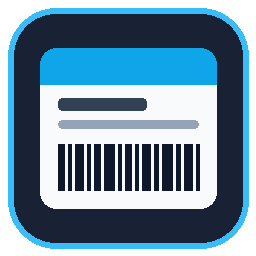

# DOS Label Preview

Aplikasi desktop standalone berbasis **Rust** (`eframe`/`egui` + `resvg`) untuk mem-preview dan mengekspor file label printer **Intermec IPL** berformat `.DAX` dan `.TAX`.



## Fitur Utama

- **Support `.DAX` dan `.TAX`**: Parsing layout template (`.TAX`) sekaligus injeksi data dinamis (`<ESC>F"FIELD"<LF>VALUE`) pada file `.DAX`.
- **Render Grafis Bit-per-Pixel Printer (IPL UDC)**: Mendukung deklarasi grafis `<STX>G<id>,...;x<W>;y<H>;<ETX>`, data kolom 6-bit `<STX>u<col>,<data>;<ETX>`, serta penempatan `<STX>U...;c<id>;<ETX>` menjadi vektor SVG yang tajam.
- **Rotasi & Skala IPL Akurat**: Mendukung rotasi berlawanan arah jarum jam (`f0`, `f1`, `f2`, `f3`), garis (`L`), barcode Code39 (`B`), serta skala lebar/tinggi font (`wN`, `hN`, `kN`).
- **Drag & Drop + Fit Window**: Drag-and-drop file langsung ke jendela aplikasi, otomatis menyesuaikan ukuran preview agar pas di window, serta zoom & pan interaktif.
- **Ekspor `.TAX`, `.DAX`, dan `.SVG`**: Edit tata letak maupun data uji lalu simpan kembali ke `.TAX` / `.DAX` tanpa merusak header/footer IPL asli, grafis `G`/`u`, maupun field ID (`H`/`B`/`L`/`U`).
- **Editor Visual Interaktif**: Klik untuk memilih elemen di kanvas, *drag* langsung untuk mengubah posisi `(X, Y)`, atau ubah properti (`h`, `w`, `l`, font `c`, rotasi `f0..f3`, teks statis / nilai DAX) melalui panel **Daftar Elemen & Inspector** di sisi kanan, lengkap dengan **Undo/Redo (`Ctrl+Z` / `Ctrl+Y`)**.
- **Tambah Elemen Baru & Import Gambar**: Tambah **Teks (`H`)**, **Garis (`L`)**, **Kotak (`W`)**, **Barcode Code 39 (`B`)**, **QR Code (`B`)**, atau **Import Grafis PNG/JPG/BMP** (otomatis dikonversi ke format bit-per-pixel IPL 6-bit `G`+`u`), serta **Duplikat** & **Hapus** elemen.
- **Single Standalone `.exe`**: Tidak membutuhkan Python, Qt, atau runtime eksternal di Windows 10/11.

## Cara Menggunakan

1. Jalankan `dos_label_preview.exe`.
2. Drag-and-drop file `.DAX` atau `.TAX` ke jendela aplikasi (atau klik **Buka File (.DAX / .TAX)**).
3. Gunakan scroll mouse untuk zoom, drag untuk menggeser, atau klik **Fit Window** untuk menyesuaikan tampilan ke ukuran jendela.
4. Klik **Simpan SVG** jika ingin mengekspor hasil render ke format SVG.

## Build dari Source

Pastikan Rust toolchain (`cargo` & `rustc`) sudah terpasang:

```powershell
cargo test
cargo build --release
```

Hasil executable standalone akan berada di `target\release\dos_label_preview.exe`.
